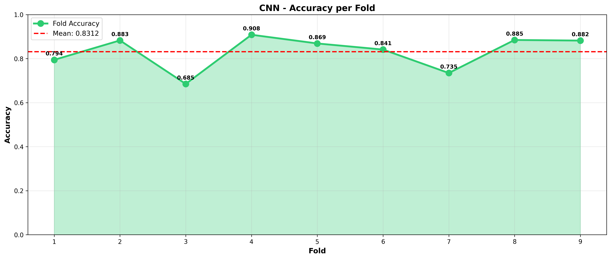

# IoT Botnet Detection on N-BaIoT — Attention-Residual CNN vs. Classical Baselines

Multi-class detection of IoT botnet traffic (**Mirai** and **Bashlite/Gafgyt** variants vs. benign) on the **N-BaIoT** dataset, evaluated with **leave-one-device-out (LODO) cross-validation**: each of the 9 IoT devices is held out in turn, so every model is tested on a device it has never seen during training.

The proposed model is a 1-D **attention-residual CNN** (a learned feature-attention layer followed by convolutional residual blocks), compared against five classical baselines.

## Results (9-fold leave-one-device-out)

| Model | Accuracy | Precision | Recall | F1 |
|---|---|---|---|---|
| MLP | **87.38 %** | 86.85 % | 90.35 % | 87.59 % |
| XGBoost | 86.92 % | 90.49 % | 90.60 % | **90.53 %** |
| LightGBM | 86.46 % | 90.67 % | 90.64 % | 88.79 % |
| Random Forest | 86.11 % | 89.82 % | 90.27 % | 88.35 % |
| Attention-Residual CNN (proposed) | 84.97 % | 83.14 % | 87.95 % | 84.73 % |
| Logistic Regression | 73.96 % | 74.74 % | 75.32 % | 73.60 % |

**Takeaway.** Under strict cross-device evaluation, tree ensembles and the MLP slightly outperform the CNN on N-BaIoT's 115 statistical flow features, while all non-linear models clearly beat the linear baseline. Generalising to unseen devices is the hard part — CNN accuracy ranges from **68.5 %** (Ennio doorbell) to **90.8 %** (Philips baby monitor):

| Held-out device | CNN accuracy |
|---|---|
| Danmini Doorbell | 79.43 % |
| Ecobee Thermostat | 88.26 % |
| Ennio Doorbell | 68.50 % |
| Philips B120N10 Baby Monitor | 90.83 % |
| Provision PT-737E Camera | 86.88 % |
| Provision PT-838 Camera | 84.10 % |
| Samsung SNH-1011-N Webcam | 73.45 % |
| SimpleHome XCS7-1002 Camera | 88.46 % |
| SimpleHome XCS7-1003 Camera | 88.18 % |

Every number above is produced by the scripts in `src/` — see `results/<model>/final_metrics.csv` and `per_fold_results.csv`.



## Model

```
115 flow features ─► Feature attention (Linear + Sigmoid gating)
                 ─► Conv1d(1→32) + BN + ReLU
                 ─► Residual block ×2  (Conv1d-BN-ReLU-Conv1d-BN + skip)
                 ─► Global average pool ─► FC 128 ─► Dropout 0.4 ─► softmax
```

The attention weights are saved per fold, so you can see which N-BaIoT features the model relies on (`results/results_cnn/visualizations/7_attention_analysis.png`).

## Repository layout

```
src/
  preprocessing.py                  # builds the 9 leave-one-device-out folds (.npz)
  cnn_attention_residual.py         # proposed CNN — trains all folds + plots
  baseline_logistic_regression.py
  baseline_random_forest.py
  baseline_xgb_lgbm_mlp.py          # XGBoost, LightGBM and MLP baselines
results/
  results_<model>/                  # final_metrics.csv, per_fold_results.csv, figures
  all_models_comparison.csv
```

## Reproduce

1. Download N-BaIoT from the UCI repository — https://archive.ics.uci.edu/dataset/442 — into `data/` (one folder per device).
2. Install and run:

```bash
pip install -r requirements.txt
python src/preprocessing.py                  # -> preprocessed_data/fold_XX_<device>.npz
python src/baseline_logistic_regression.py
python src/baseline_random_forest.py
python src/baseline_xgb_lgbm_mlp.py
python src/cnn_attention_residual.py         # ~2.5 h on CPU for all 9 folds
```

Paths can be overridden with the `NBAIOT_DATA`, `NBAIOT_PREPROCESSED` and `NBAIOT_BASE` environment variables.

## Related

- Live demo dashboard: https://github.com/Tarun-Pradeep/iot-botnet-msa-cnn-dashboard
- Research presented orally at an IEEE conference (Jul 2026).

## Authors

Tarun Pradeep, Varun Suresh Kumar — supervised by Dr. Ceronmani Sharmila V
